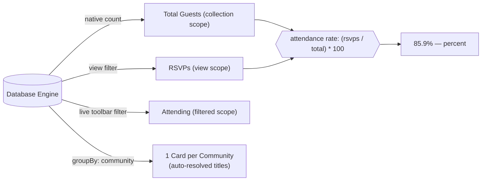
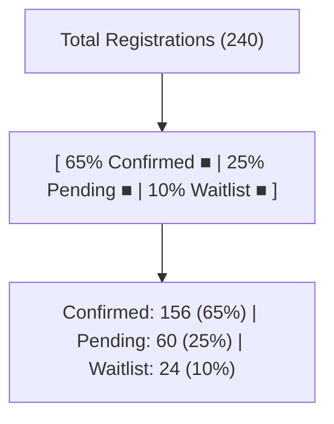

A metric is a KPI card that sits above your operational view. Instead of loading thousands of records into browser memory to calculate revenue or counts, the view runs native database aggregate queries (`count`, `sum`, `avg`, `min`, `max`, `distinctCount`) directly on the backend engine. You can also combine results with JEXL math expressions, break them down dynamically with `groupBy`, or scope them to react live to user filters.

By the end of this guide, you will know how to configure database aggregates, control filter scoping, dynamically group cards across relationships or categories, and customize metrics in code or directly from the Admin UI.

## Visual outcome



Because aggregations run directly on your database engine, cards compute summary stats across tens of thousands of documents in milliseconds without table scans or client-side bottlenecks.

## Metric scoping

By default, a metric card evaluates against the view's base filter. However, different operational questions require different boundaries: you might want a global benchmark that never changes, or a reactive counter that updates as someone types in the search bar.

Dyrected provides three distinct scopes:

| Scope | Behavior | When to use |
| --- | --- | --- |
| `'view'` *(default)* | Evaluates against the view's predefined `filter`. Ignores temporary user searches or column filters. | Stable operational baselines (e.g. total records assigned to this pipeline stage). |
| `'filtered'` | Re-aggregates live whenever an operator searches, sorts, or filters rows in the table toolbar. | Interactive drill-downs (e.g. seeing total order value update as you filter by region). |
| `'collection'` | Evaluates across the entire collection, ignoring both the view filter and table toolbar filters. | Global reference benchmarks (e.g. comparing this view's count against all records in the company). |

### Setting a view-wide default scope

If you want all metric cards in an operational view to react live to table searches and column filters, set `metricsScope: "filtered"` on the view definition:

```ts
import { defineView } from "@dyrected/core";

export const eventGuestsView = defineView({
  slug: "attending-guests",
  label: "Attending Guests",
  layout: "table",
  filter: { attending: { equals: true } },
  columns: ["name", "tableNumber", "guestCount"],
  // All metric cards in this view update live when searching or filtering
  metricsScope: "filtered",
  metrics: [
    {
      label: "Matching Guests",
      color: "emerald",
      aggregate: { count: "*" },
    },
  ],
});
```

When an operator filters the table by table number or searches for a name, the "Matching Guests" card recalculates live against only the matching records.

### Overriding scope per card or sub-metric

You can also mix scopes within the same view. For example, you can display a global collection total right next to a filtered view count:

```ts
import { defineView } from "@dyrected/core";

export const guestCheckInView = defineView({
  slug: "door-checkin",
  label: "Door Check-in",
  layout: "table",
  filter: { attending: { equals: true } },
  columns: ["name", "checkedIn"],
  metrics: [
    {
      label: "Active Search Count",
      color: "emerald",
      // Re-aggregates live as operators type in search or filter columns
      scope: "filtered",
      aggregate: { count: "*" },
    },
    {
      label: "Total Invited",
      color: "blue",
      // Always counts the entire guests collection regardless of filters
      scope: "collection",
      aggregate: { count: "*" },
    },
  ],
});
```

Dyrected displays a subtle scope indicator icon in the top right corner of cards that override default scoping:
- **Filter icon**: Indicates `'filtered'` scope (live synchronization with toolbar filters).
- **Database icon**: Indicates `'collection'` scope (global database totals).
- **Layers icon**: Indicates `'view'` scope.

## Dynamic grouping with `groupBy`

Instead of hardcoding separate metric cards for every department, community, or status, you can provide `groupBy: "fieldName"`. Dyrected automatically queries distinct groups and generates dynamic items in a single, batched database aggregation query.

### Grouping cards (1 card per group)

Setting `groupBy` on a primary metric card expands that definition into multiple sibling cards:

```ts
import { defineView } from "@dyrected/core";

export const guestsByCommunity = defineView({
  slug: "community-breakdown",
  label: "Community Breakdown",
  layout: "table",
  columns: ["name", "community", "tableNumber"],
  metrics: [
    {
      // {{group.label}} renders the resolved name (e.g. "Ikoyi", "Victoria Island")
      label: "{{group.label}} Guests",
      color: "purple",
      unit: "Guests",
      groupBy: "community",
      aggregate: { count: "*" },
    },
  ],
});
```

If your collection contains records belonging to three communities, Dyrected automatically renders three cards side-by-side: "Ikoyi Guests", "Victoria Island Guests", and "Lekki Guests".

### Grouping sub-metrics (breakdown rows inside a card)

If you prefer a single card with compact breakdown rows in its footer, place `groupBy` on a sub-metric instead:

```ts
import { defineView } from "@dyrected/core";

export const rsvpSummaryView = defineView({
  slug: "rsvp-summary",
  label: "RSVP Summary",
  layout: "table",
  columns: ["name", "status", "partySize"],
  metrics: [
    {
      label: "Total Registrations",
      color: "indigo",
      aggregate: { count: "*" },
      subMetrics: [
        {
          // Expands into multiple rows inside the footer (e.g. "Confirmed", "Declined", "Waitlist")
          label: "{{group.label}}",
          groupBy: "status",
          aggregate: { count: "*" },
        },
      ],
    },
  ],
});
```

### Supported field types and label resolution

The `groupBy` option supports multiple field types:

1. **Relationship fields**: Dyrected inspects the related collection and automatically resolves document IDs to human-readable titles using the related collection's `admin.useAsTitle` setting (or fallback fields like `title`, `name`, or `label`).
2. **Select and radio fields**: Dyrected looks up the option definition and displays the human-friendly option label instead of raw internal values.
3. **Boolean fields**: Formatted cleanly as `true` / `false` or customizable labels.
4. **Scalar fields**: Text, numbers, or category codes.

### Template tokens

In your `label` string, use double curly braces to interpolate group data:

- `{{group.label}}`: The human-readable label (e.g., the related document title, the select option label, or formatted boolean).
- `{{group.value}}`: The raw stored database value or document ID.

### Advanced group configuration

When you need to control limits, ordering, or filter which groups appear, pass a configuration object instead of a field string:

```ts
{
  label: "{{group.label}} Top Sellers",
  color: "emerald",
  groupBy: {
    field: "category",
    limit: 5,            // Show only top 5 groups (Top-N)
    orderBy: "count",    // Order groups descending by aggregate count ("count", "asc", or "desc")
    where: { active: { equals: true } }, // Filter eligible groups
  },
  aggregate: { count: "*" },
}
```

In the Admin UI customizer, you can configure these options directly from dropdown selects under the **Group By** field without writing code.

### High-cardinality groups and the "Other (N)" drilldown popover

Real-world datasets often have fields with high cardinality — such as 35 customer communities, 40 sales territories, or 100 fulfillment hubs. Displaying 35 distinct cards or 35 footer rows would crowd the screen and defeat the purpose of an executive overview.

When you specify a `limit` on a sub-metric `groupBy` (e.g. `limit: 5`), Dyrected automatically:

1. Displays the top 5 groups based on your ordering rule.
2. Rolls up all remaining 30 groups into a clean, interactive **"Other (30)"** item.
3. Automatically computes the aggregate total and percentage share across those remaining groups.

```ts
import { defineView } from "@dyrected/core";

export const communityBreakdownView = defineView({
  slug: "community-summary",
  label: "Community Summary",
  layout: "table",
  columns: ["name", "community", "status"],
  metrics: [
    {
      label: "Total Guests",
      color: "amber",
      aggregate: { count: "*" },
      subMetrics: [
        {
          label: "{{group.label}}",
          // Out of 35 communities, top 5 display directly, and 30 roll into "Other (30)"
          groupBy: {
            field: "community",
            limit: 5,
            orderBy: "count",
          },
          aggregate: { count: "*" },
        },
      ],
    },
  ],
});
```

When an operator clicks the **"Other (30)"** item, Dyrected opens an interactive popover with a live search bar and a scrollable list of all 30 long-tail communities. Clicking any community in the popover immediately filters the view to records in that community.

### Time-bucket grouping (`bucket`)

When grouping by a date or datetime field (such as `createdAt` or `orderDate`), setting `bucket` groups records into chronological intervals rather than individual timestamps.

You can bucket metrics across five time grains: `'day'`, `'week'`, `'month'`, `'quarter'`, or `'year'`.

```ts
import { defineView } from "@dyrected/core";

export const monthlySignupsView = defineView({
  slug: "monthly-signups",
  label: "Monthly Signups",
  layout: "table",
  columns: ["name", "email", "createdAt"],
  metrics: [
    {
      label: "{{group.label}} Registrations",
      color: "blue",
      groupBy: {
        field: "createdAt",
        bucket: "month",
        limit: 6,
        orderBy: "desc",
      },
      aggregate: { count: "*" },
    },
  ],
});
```

Dyrected generates dynamic cards with human-readable labels (e.g. `"Oct 2026"`, `"Sep 2026"`, `"Aug 2026"`). When an operator clicks any time-bucket card, it applies an `isBetween` filter matching the exact beginning and end of that calendar interval, instantly focusing the view on rows created during that window.

## Card layout and column spanning

By default, metric cards occupy a single responsive column in the top summary grid. For hero metrics, wide revenue summaries, or cards with detailed sub-metric distributions, you can specify `span` to give the card a wider footprint:

```ts
import { defineView } from "@dyrected/core";

export const financialExecutiveView = defineView({
  slug: "financial-summary",
  label: "Financial Summary",
  layout: "table",
  metrics: [
    {
      label: "Gross Revenue Performance",
      color: "emerald",
      // Spans 2 grid columns on tablet/desktop displays
      span: 2,
      aggregate: { sum: "amount", where: { status: { equals: "paid" } } },
      format: "currency",
      currency: "USD",
      subMetrics: [
        { label: "Subscriptions", aggregate: { sum: "amount", where: { type: { equals: "subscription" } } } },
        { label: "One-Time Sales", aggregate: { sum: "amount", where: { type: { equals: "one_time" } } } },
        { label: "Add-Ons", aggregate: { sum: "amount", where: { type: { equals: "addon" } } } },
      ],
    },
    {
      label: "Refund Rate",
      color: "rose",
      // Standard single-column width
      span: 1,
      expression: "(aggregates.refunds / aggregates.total) * 100",
      aggregates: {
        refunds: { count: "*", where: { status: { equals: "refunded" } } },
        total: { count: "*" },
      },
      format: "percent",
    },
  ],
});
```

Supported span values:
- `1` *(default)*: Standard single-column card width.
- `2`: Spans 2 columns on medium (`md`) and desktop screens.
- `3`: Spans 3 columns on desktop screens.
- `4`: Spans 4 columns on large desktop screens.
- `"full"`: Spans the full width of the view header across all desktop viewports.

On mobile viewports, cards automatically adapt into single-column cards to ensure labels and touch targets remain legible.

## Interactive quick-filters (drill-down on click)

Metric cards are not just passive displays; they double as interactive navigation controls for your operational view.

When an operator spots an interesting figure on a card or sub-metric row:
- **Card click**: Clicking a grouped card or single-aggregate card immediately applies an active filter (e.g. clicking "Lagos Guests" filters the view to records where `community` equals Lagos).
- **Sub-metric click**: Clicking a sub-metric row (e.g. "Pending") immediately filters the view to rows matching that specific condition (`status: "pending"`).
- **Distribution segment click**: Clicking a slice on the horizontal distribution bar applies the corresponding sub-metric filter.
- **Active state indicator**: Active cards and sub-metrics display an **Active** badge and a high-contrast highlight ring, showing at a glance which metric is currently filtering the view.
- **Click again to clear**: Clicking an active card or sub-metric toggles the filter off, restoring the full view.

### Cross-layout synchronization

Quick-filters work seamlessly across every operational view layout:
- **Table layout**: Filters table rows dynamically.
- **Cards layout**: Filters the responsive card grid dynamically.
- **Kanban layout**: Filters grouped kanban columns and cards dynamically.
- **Spreadsheet layout**: Filters editable spreadsheet rows dynamically.
- **Calendar layout**: Filters events within the active date window dynamically.

All active filters synchronize with the browser URL (`?filters=...`), allowing operators to bookmark, refresh, or share filtered operational views with teammates.

## Segmented distribution bars

When a metric card includes two or more sub-metrics with positive numeric values, Dyrected automatically renders a sleek horizontal segmented distribution bar directly below the main hero value.



### Proportional breakdown & color harmony

- **Harmonic tonal palettes**: When sub-metrics don't define custom colors, Dyrected automatically picks shades from a curated tonal spectrum matching the card's color family (e.g., warm amber, orange, and gold tones on amber cards; cool violet, indigo, and fuchsia on purple cards; fresh botanical greens on emerald cards). This eliminates clashing multi-hue noise on colored cards.
- **Ambient track background**: Rather than an alien grey trench, the track background automatically inherits a subtle ambient tint of the card's color family (`trackBg`), ensuring a premium, unified appearance in both light and dark modes.
- **Visual slices & interactive tooltips**: Each sub-metric receives a proportional slice of the bar (`value / total * 100%`) with micro-hover scaling and active focus rings. Hovering over any slice reveals the label, formatted number, and calculated percentage. Clicking a slice instantly filters the operational view.
- **Explicit color overrides**: If you specify explicit colors on individual sub-metrics (e.g. `color: "emerald"` for completed, `color: "rose"` for failed, `color: "amber"` for pending), Dyrected respects those semantic colors directly.
- **Matching legend dots**: Each sub-metric row in the card footer displays a matching colored indicator dot and percentage badge (`(65%)`), creating effortless visual continuity between the bar and the summary text.

### Customizing or disabling distribution bars

Distribution bars are enabled by default whenever a card has multiple sub-metrics. You can customize accent colors per sub-metric or opt out using `showDistribution: false`:

```ts
import { defineView } from "@dyrected/core";

export const orderFulfillmentView = defineView({
  slug: "fulfillment",
  label: "Order Fulfillment",
  layout: "table",
  metrics: [
    {
      label: "Total Orders",
      aggregate: { count: "*" },
      // Optional: set to false to hide the distribution bar
      showDistribution: true,
      subMetrics: [
        {
          label: "Shipped",
          color: "emerald", // Custom slice color
          aggregate: { count: "*", where: { status: { equals: "shipped" } } },
        },
        {
          label: "Processing",
          color: "amber",
          aggregate: { count: "*", where: { status: { equals: "processing" } } },
        },
        {
          label: "Cancelled",
          color: "rose",
          aggregate: { count: "*", where: { status: { equals: "cancelled" } } },
        },
      ],
    },
  ],
});
```

You can also toggle the distribution bar on or off directly inside the Admin UI customizer when editing metrics.

## Period-over-period trend deltas (`trend`)

KPI numbers are most meaningful in context. Instead of just seeing "142 Signups" in isolation, operators want to know if performance is accelerating or slowing down compared to last week or last month.

Adding a `trend` configuration automatically computes the percentage delta against the preceding time window and renders a high-contrast trend badge next to the main figure:

```ts
import { defineView } from "@dyrected/core";

export const revenueTrendsView = defineView({
  slug: "sales-performance",
  label: "Sales Performance",
  layout: "table",
  columns: ["orderNumber", "customer", "totalAmount", "createdAt"],
  metrics: [
    {
      label: "Monthly Net Revenue",
      color: "emerald",
      format: "currency",
      currency: "USD",
      aggregate: {
        sum: "totalAmount",
        where: {
          createdAt: {
            gte: "2026-10-01T00:00:00.000Z",
            lte: "2026-10-31T23:59:59.999Z",
          },
        },
      },
      trend: {
        dateField: "createdAt",
        period: "previous_month",
      },
      subMetrics: [
        {
          label: "New Customer Orders",
          aggregate: {
            count: "*",
            where: {
              customerType: { equals: "new" },
              createdAt: {
                gte: "2026-10-01T00:00:00.000Z",
                lte: "2026-10-31T23:59:59.999Z",
              },
            },
          },
          trend: {
            period: "previous_month",
          },
        },
      ],
    },
  ],
});
```

If revenue grew by 14.2% over September, Dyrected displays `+14.2% ↑` in an emerald badge beside the headline number. On sub-metrics in the card footer, trend deltas appear as compact directional tags.

### Comparison periods

The `period` property determines the baseline comparison window:

| Period | Comparison baseline | Typical use case |
| --- | --- | --- |
| `'previous_period'` *(default)* | Shifts the current evaluation window back by its exact duration. If viewing the last 7 days, compares against the preceding 7 days. | Default adaptive comparisons matching the active date filter. |
| `'previous_day'` | Shifts the comparison baseline back by exactly 1 day. | Daily tracking, comparing today's volume against yesterday. |
| `'previous_week'` | Shifts the comparison baseline back by exactly 7 days. | Weekly sprints and comparing day-of-week patterns. |
| `'previous_month'` | Shifts the comparison baseline back by exactly 1 calendar month. | Monthly executive reviews and recurring billing cycles. |
| `'previous_year'` | Shifts the comparison baseline back by exactly 1 calendar year. | Year-over-year (YoY) growth and seasonal tracking. |

### Zero-N+1 batched execution

To prevent performance degradation on high-traffic operational dashboards, Dyrected fans previous period queries directly into the primary database aggregation request. Current and historical numbers are computed in a single round-trip database query, ensuring instant dashboard rendering even across hundreds of thousands of records.

### Inverting color polarity (`invertColors`)

By default, an upward delta (`+14%`) renders in emerald and a downward delta (`-5%`) renders in rose.

For metrics where increases are undesirable — such as customer churn, response times, bug reports, or error rates — set `invertColors: true`. An increase will display with a rose warning badge, while a reduction in churn or errors will render with an emerald success badge:

```ts
{
  label: "Open Critical Bugs",
  color: "rose",
  aggregate: { count: "*", where: { status: { equals: "open" }, severity: { equals: "critical" } } },
  trend: {
    dateField: "createdAt",
    period: "previous_week",
    // Reductions in bug counts show in emerald, while increases show in rose
    invertColors: true,
  },
}
```

## Configuration patterns

### 1. Simple count metric

Count matching documents directly in the database:

```ts
import { defineView } from "@dyrected/core";

export const attendingGuests = defineView({
  slug: "attending-guests",
  label: "Attending Guests",
  layout: "table",
  filter: { attending: { equals: true } },
  columns: ["name", "guestCount"],
  metrics: [
    {
      label: "Total Attending",
      color: "emerald",
      aggregate: { count: "*", where: { attending: { equals: true } } },
    },
  ],
});
```

### 2. Distinct count of unique values

Count unique non-null values for a field (e.g. how many distinct tables have seated guests):

```ts
export const occupiedTables = {
  label: "Occupied Tables",
  color: "indigo",
  unit: "Tables",
  aggregate: {
    distinctCount: "tableNumber",
    where: { attending: { equals: true } },
  },
};
```

### 3. Calculated revenue with `transform`

Multiply an aggregated numeric sum by a unit price:

```ts
export const revenueMetric = {
  label: "Estimated Revenue",
  color: "rose",
  aggregate: {
    sum: "asoebiQuantity",
    cast: "number",
    where: { asoebiStatus: { in: ["paid", "collected"] } },
  },
  transform: "value * 25000",
  format: "currency",
  currency: "NGN", // Displays as: ₦2,125,000
};
```

In `transform`, `value` represents the numeric result returned by the database operation.

### 4. Multi-aggregate expressions & ratios

Combine multiple database operations using an `expression`:

```ts
export const attendanceRate = {
  label: "Attendance Rate",
  color: "amber",
  aggregates: {
    totalInvited:   { count: "*" },
    totalAttending: { count: "*", where: { attending: { equals: true } } },
  },
  expression: "math.round((aggregates.totalAttending / aggregates.totalInvited) * 100, 1)",
  format: "percent", // Displays as: 85.9%
};
```

### 5. Multi-submetric card

Show a primary headline count alongside static secondary breakdown items:

```ts
export const checkInMetric = {
  label: "Door Check-In",
  color: "emerald",
  unit: "Guests",
  aggregates: {
    checkedIn: { count: "*", where: { checkedIn: { equals: true } } },
    attending: { count: "*", where: { attending: { equals: true } } },
  },
  expression: "aggregates.checkedIn",
  subMetrics: [
    {
      label: "Pending",
      aggregates: {
        checkedIn: { count: "*", where: { checkedIn: { equals: true } } },
        attending: { count: "*", where: { attending: { equals: true } } },
      },
      expression: "aggregates.attending - aggregates.checkedIn",
    },
  ],
};
```

## Explaining a metric with `description`

A number is only useful if everyone reads it the same way. Add a `description` to say what a card counts, over what period, and with which filter:

```ts
import { defineConfig, defineView } from "@dyrected/core";

export default defineConfig({
  collections: [],
  admin: {
    navigation: [
      {
        slug: "billing",
        label: "Billing",
        collection: "invoices",
        views: [
          defineView({
            slug: "overview",
            label: "Overview",
            collection: "invoices",
            metrics: [
              {
                label: "Collected",
                description: "Payments **received** in the last `30` days, before refunds.",
                aggregate: { sum: "amount", cast: "number", where: { status: "paid" } },
                format: "currency",
                currency: "USD",
                subMetrics: [
                  {
                    label: "Cash",
                    description: "Paid at the till. Card payments are counted separately.",
                    aggregate: { sum: "amount", cast: "number", where: { method: "cash" } },
                  },
                ],
              },
            ],
          }),
        ],
      },
    ],
  },
});
```

Cards that have a description show a small **i** icon next to their title. Cards without one look exactly as before.

- **On a computer with a mouse or trackpad:** hover the icon (or tab to it) to see a tooltip.
- **On a phone or tablet:** tap the icon and a sheet slides up from the bottom of the screen with the title and the explanation. Tap outside it or use the close button to dismiss it.

The choice follows the input device, not the window width, so a narrow desktop window still gets the tooltip. Tapping or pressing the icon never filters the view, even when the card itself is clickable.

A sub-metric's `description` is listed under the card's own description in the same tooltip or sheet. If several breakdown rows share one description, which is what a `groupBy` breakdown produces, it is shown once with all their labels.

### What you can write in a description

Descriptions are plain text with a small, safe subset of markdown:

| You write | It shows |
| --- | --- |
| `**bold**` | **bold** |
| `*italic*` | *italic* |
| `` `code` `` | `code`, useful for formulas such as `` `paid ÷ billed` `` |
| `[the guide](https://example.com/guide)` | a link that opens in a new tab |

Symbols such as `÷ × ≥ ≤ %` work as ordinary text. Headings, lists, images and HTML are not supported and appear as written.

Keep links in mind:

- Only full `https://`, `http://` and `mailto:` addresses become links. Anything else, such as a relative path or a `javascript:` address, shows as plain text.
- On a computer, a description with a link opens when you click the icon instead of on hover, so you can reach the link.
- Keep descriptions short. If a metric needs a paragraph, link to a page that explains it.

### Using the same hint in your own dashboard

The built-in dashboard shows recent edits and items that need attention, not numeric metrics, so there is nothing to describe there. If you build your own stats in a React [custom dashboard component](/docs/editor-experience/custom-components/dashboard), reuse the same hint so it behaves identically on desktop and mobile:

```tsx
import { InfoHint } from "@dyrected/admin/public";

export function RevenueStat({ value }: { value: string }) {
  return (
    <div className="flex items-center gap-1.5">
      <span>Revenue</span>
      <InfoHint title="Revenue" description="Payments **received** this month." />
      <strong>{value}</strong>
    </div>
  );
}
```

`InfoHint` and `InlineMarkdown` are exported for React components only. Vue components in a Nuxt project do not have an equivalent yet, so build the tooltip with your own markup there.

## Customizing metrics in the Admin UI

Operators and administrators can customize metrics directly in the Dyrected Admin UI without editing code.

1. Open any collection and click the **Customize** or gear icon in the navigation header.
2. In the Navigation Customizer, click the view you wish to edit and expand **Metrics (KPI Cards)**.
3. Click any metric chip in the **ViewMetricsBuilder** to select it.
4. From the edit drawer:
   - Toggle the **Scope** (`"View Filtered"`, `"Live Table Filter"`, or `"Entire Collection"`).
   - Choose a **Group By** field to turn the card into dynamic groups.
   - Adjust the card color palette or label.
5. If you want to reset any customized view back to the developer's original configuration in code, click the **Revert View** button.

## Options reference

### `ViewConfigBase` options

| Property | Type | Default | Description |
| --- | --- | --- | --- |
| `metricsScope` | `'view' \| 'filtered' \| 'collection'` | `'view'` | Default filter scoping for all metric cards in this operational view. |
| `metrics` | `ViewMetric[]` | `[]` | Array of KPI metric cards rendered above the view content. |

### `ViewMetric` options

| Property | Type | Description |
| --- | --- | --- |
| `label` | `string` **required** | Title displayed on the metric card. Supports `{{group.label}}` and `{{group.value}}` when `groupBy` is set. |
| `description` | `string` | Explains what the number means. Shows an info icon: a tooltip on hover, a bottom sheet on touch screens. Supports `**bold**`, `*italic*`, `` `code` `` and `[links](https://…)`. |
| `color` | `MetricColor` | Theme palette accent (`"purple"`, `"emerald"`, `"amber"`, `"rose"`, `"blue"`, `"indigo"`, `"cyan"`, `"orange"`). |
| `span` | `1 \| 2 \| 3 \| 4 \| 'full'` | Responsive grid column span. Defaults to `1`. Set to `2`, `3`, `4`, or `'full'` for wide hero cards. |
| `unit` | `string` | Optional unit badge displayed alongside the hero value (e.g. `"Guests"`, `"Orders"`, `"Tables"`). |
| `scope` | `'view' \| 'filtered' \| 'collection'` | Scoping override for this card. Defaults to the view's `metricsScope` (or `'view'`). |
| `groupBy` | `string \| ViewMetricGroupByConfig` | Dynamic breakdown: generates 1 card per distinct group value, related document, or time bucket. |
| `aggregate` | `AggregateOperation` | Single operation `{ count: "*", distinctCount: "field", sum: "field", avg: "field", min: "field", max: "field", where?, cast?: "number" }`. |
| `aggregates` | `Record<string, AggregateOperation>` | Named map of operations referenced in `expression` as `aggregates.key`. |
| `transform` | `string` | JEXL formula evaluated over `value` for single aggregates (e.g. `"value * 100"`). |
| `expression` | `string` | JEXL formula evaluated over `aggregates` (e.g. `"aggregates.a + aggregates.b"`). |
| `trend` | `ViewMetricTrendConfig` | Period-over-period trend delta comparison configuration. Renders a hero badge (e.g. `+14.2% ↑`). |
| `format` | `"currency"` \| `"number"` \| `"percent"` | Formatter applied to the final number. |
| `currency` | `string` | 3-letter currency code (e.g. `"USD"`, `"NGN"`, `"EUR"`) used when `format: "currency"`. |
| `showDistribution` | `boolean` | Controls the horizontal segmented distribution bar. Defaults to `true` when 2+ sub-metrics have numbers. |
| `subMetrics` | `ViewSubMetric[]` | Array of sub-metrics displayed in a compact breakdown footer under the main card. |

### `ViewSubMetric` options

| Property | Type | Description |
| --- | --- | --- |
| `label` | `string` **required** | Label for the breakdown row. Supports `{{group.label}}` and `{{group.value}}`. |
| `description` | `string` | Explains this breakdown row. Listed under the card's description in the same tooltip or sheet. Same inline markdown as the card. |
| `color` | `MetricColor` | Theme accent color for this sub-metric item and its distribution bar segment. |
| `scope` | `'view' \| 'filtered' \| 'collection'` | Scoping override for this sub-metric row. Defaults to the parent card's scope. |
| `groupBy` | `string \| ViewMetricGroupByConfig` | Groups this sub-metric by field, relationship, or time bucket, expanding into multiple footer rows. |
| `aggregate` | `AggregateOperation` | Single database aggregate operation. |
| `aggregates` | `Record<string, AggregateOperation>` | Named map of operations referenced in `expression`. |
| `transform` | `string` | JEXL formula evaluated over `value`. |
| `expression` | `string` | JEXL formula evaluated over `aggregates`. |
| `trend` | `ViewMetricTrendConfig` | Period-over-period trend delta configuration. Renders a compact directional tag. |
| `format` | `"currency"` \| `"number"` \| `"percent"` | Formatter applied to the number. |
| `currency` | `string` | 3-letter currency code when `format: "currency"`. |

### `ViewMetricGroupByConfig` options

| Property | Type | Default | Description |
| --- | --- | --- | --- |
| `field` | `string` **required** | — | Target field name or relationship field to group by. |
| `bucket` | `'day' \| 'week' \| 'month' \| 'quarter' \| 'year'` | — | Chronological grouping intervals when `field` is a date or datetime. |
| `limit` | `number` | — | Maximum number of top groups to display. Sibling sub-metrics rollup the rest into an interactive "Other (N)" popover. |
| `orderBy` | `'count' \| 'asc' \| 'desc'` | `'count'` | Sort order for groups (`'count'` orders by highest frequency, `'asc'` / `'desc'` sorts by group value). |
| `where` | `Filter` | — | Filter condition applied when discovering distinct groups. |

### `ViewMetricTrendConfig` options

| Property | Type | Default | Description |
| --- | --- | --- | --- |
| `dateField` | `string` | `"createdAt"` | Date or datetime field used to partition the evaluation period. |
| `period` | `'previous_period' \| 'previous_day' \| 'previous_week' \| 'previous_month' \| 'previous_year'` | `'previous_period'` | Comparison baseline period. |
| `invertColors` | `boolean` | `false` | When `true`, flips color polarity so decreases display as emerald and increases display as rose (e.g. for churn or error counts). |

## UX guardrails

- **2–4 cards per view**: Keep the metric row focused on primary operational indicators. When using `groupBy` on cards, set a sensible `limit` (e.g. 4–6) to prevent excessive cards from crowding the screen.
- **Percentages are 0–100**: Formulas formatted with `format: "percent"` should output values in the range `0–100`.
- **Adaptive mobile layout**: Cards with `subMetrics` automatically expand full-width on mobile viewports for clean horizontal readability.

## Next steps

- Add workflow buttons — [Actions](/docs/model-content/operational-views/actions)
- Configure view layouts — [Define a view](/docs/model-content/operational-views/define-view)
- Layout best practices — [UX guidelines](/docs/model-content/operational-views/ux-guidelines)

